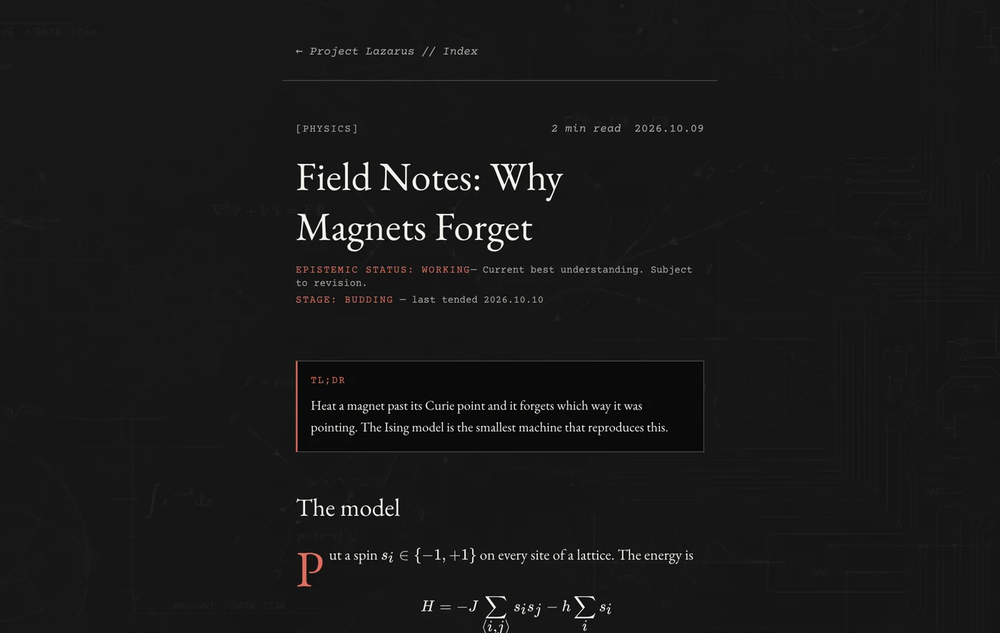
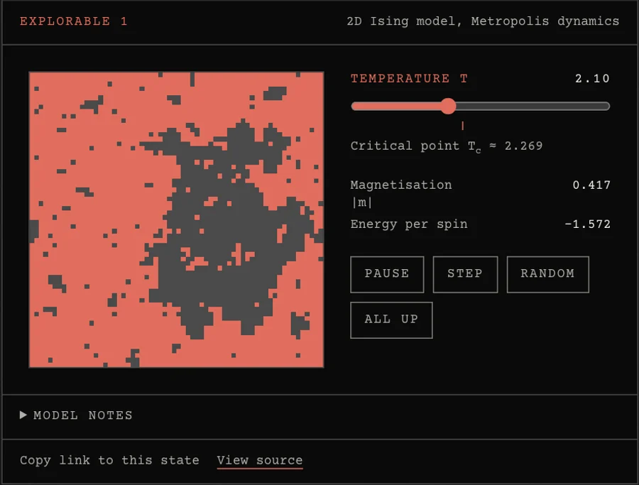

<div align="center">

<br>

# Project Lazarus

**Research notes, working papers, and a few things you can break.**

An archival blog and digital garden. Dark and light. Quietly experimental.

<br>

[**Read**](https://abhicodz.github.io/Project-Lazarus/) &nbsp;·&nbsp;
[Start here](https://abhicodz.github.io/Project-Lazarus/start/) &nbsp;·&nbsp;
[The Lab](https://abhicodz.github.io/Project-Lazarus/lab/) &nbsp;·&nbsp;
[Write](https://abhicodz.github.io/Project-Lazarus/write/)

<br>

[](https://github.com/ABHICODZ/Project-Lazarus/actions/workflows/deploy.yml)


<br>

<picture>
  <source media="(prefers-color-scheme: light)" srcset="docs/hero-light.webp">
  
</picture>

</div>

<br>

Most blogs are timelines. Lazarus is a garden: finished essays sit beside seedling notes, they link to each other, and some of them contain experiments the reader can break.

## Highlights

- **Essays you can poke.** Embedded explorables, starting with an Ising model whose state lives in the URL, plus predict-then-reveal prompts.
- **A garden, not a feed.** Notes with growth stages, `[[wiki links]]`, backlinks and a constellation map of everything.
- **Typeset for reading.** KaTeX math, Shiki code, sidenotes, light and dark themes, and a print stylesheet.
- **Write in the browser.** Drop images in (converted to WebP on your machine), preview, and publish as a pull request.
- **Fast and quiet.** Static HTML, 16 KB of JavaScript on the home page, search that loads only when asked.
- **Guarded.** Type-checked, tested on desktop and mobile, with performance budgets and a weekly link-rot check.

<div align="center">
<br>
<picture>
  <source media="(prefers-color-scheme: light)" srcset="docs/explorable-light.webp">
  
</picture>
<br>
<sub>An explorable in an essay. Drag the temperature across the critical point.</sub>
<br><br>
</div>

## Quick start

```bash
npm install
npm run dev        # http://localhost:4321/Project-Lazarus/
```

```bash
npm run build      # type-check, build, index for search
npm test           # unit tests, then Playwright
```

Search needs a build (`npm run build && npm run preview`), because it indexes the built pages.

## Writing

Add an `.mdx` file to `src/content/blog/` for an essay or `src/content/notes/` for a note, or use [`/write`](https://abhicodz.github.io/Project-Lazarus/write/) in the browser. Frontmatter, components, images and publishing are covered in **[CONTRIBUTING.md](CONTRIBUTING.md)**.

## Built with

[Astro](https://astro.build) · [Tailwind CSS](https://tailwindcss.com) · MDX · [KaTeX](https://katex.org) · [Shiki](https://shiki.style) · [Pagefind](https://pagefind.app) · [Satori](https://github.com/vercel/satori) · [Playwright](https://playwright.dev)

## Layout

```text
src/content/blog/       essays
src/content/notes/      notes
src/components/         Sidenote, Figure, Callout, Cite, explorables
src/pages/              routes, including /write and the share-image endpoint
src/lib/                explorable helpers and the write studio
plugins/                [[wiki link]] remark plugin
tests/                  unit and Playwright tests
```

## Hosting

Deployed to GitHub Pages by [a workflow](.github/workflows/deploy.yml): pull requests build and test, and only `main` deploys. To host elsewhere, set the address at build time:

```bash
SITE_URL=https://example.com SITE_BASE=/ npm run build
```

Comments are optional and appear once giscus is configured; see [`.env.example`](.env.example).

## License

[MIT](LICENSE)
