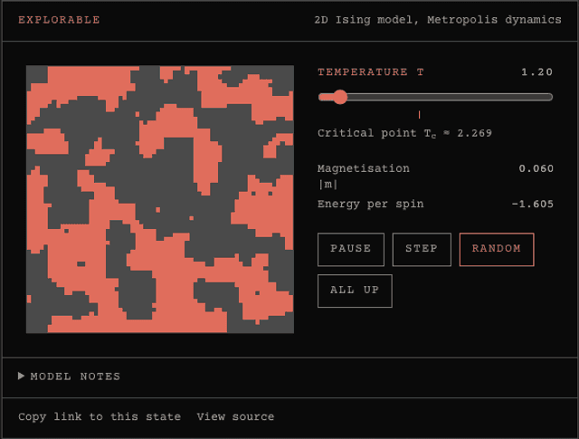
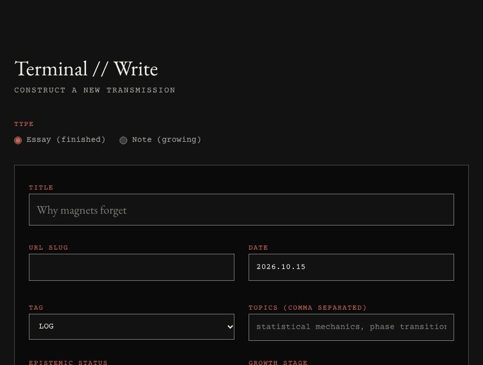
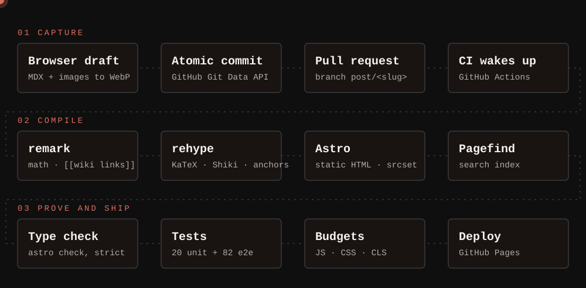

<div align="center">

<a href="https://abhicodz.github.io/Project-Lazarus/">
  
</a>

<br>

**[ ENTER THE SITE ](https://abhicodz.github.io/Project-Lazarus/)**

[Start here](https://abhicodz.github.io/Project-Lazarus/start/) &nbsp;·&nbsp; [The Lab](https://abhicodz.github.io/Project-Lazarus/lab/) &nbsp;·&nbsp; [Constellation](https://abhicodz.github.io/Project-Lazarus/constellation/) &nbsp;·&nbsp; [Write](https://abhicodz.github.io/Project-Lazarus/write/)

[](https://github.com/ABHICODZ/Project-Lazarus/actions/workflows/deploy.yml)  

</div>

<br>

> Most blogs are timelines. **Lazarus is a garden.** Finished essays sit beside seedling notes, they link to each other, and some of them have a working experiment inside.
>
> Everything below is real: the GIFs are recorded from the running site, and the numbers come from an actual build.

<br>

## 01 &nbsp;/&nbsp; The experiment

<div align="center">
  
</div>

This is a 2D Ising model running inside an essay, recorded while the temperature slider moves. Watch what the lattice does:

| Temperature | What you see |
| --- | --- |
| **1.2**, cold | Neighbours agree. Big single-colour domains grow and merge. |
| **3.6**, hot | Heat wins. The order dissolves into noise. |
| **2.27**, critical | Clusters at every scale. This is the phase transition, at T<sub>c</sub> ≈ 2.269. |

<details>
<summary><b>How it works</b></summary>

<br>

Each cell is a spin of +1 or −1. Every update picks a random cell and flips it with probability `min(1, exp(−ΔE/T))`, where ΔE comes from its four neighbours (Metropolis, 1953).

```ts
const dE = 2 * spin * neighbours;              // energy cost of flipping this spin
if (dE <= 0 || random() < Math.exp(-dE / T)) spin = -spin;
```

- **Seeded.** The same link reproduces the same start: `?ising.T=2.27&ising.seed=7`.
- **State lives in the URL**, so "copy link to this state" shares exactly what you are looking at.
- **Polite.** It pauses when scrolled off-screen, and starts paused if you prefer reduced motion.
- **Tested.** Cold lattices stay ordered, hot ones disorder, and a fixed seed reproduces its first frame.

</details>

<br>

## 02 &nbsp;/&nbsp; Write, drop an image, ship

<div align="center">
  
</div>

The clip above is the real `/write` page, start to finish:

1. **Type a title.** The URL slug follows along.
2. **Write.** Math is plain `$…$`; the toolbar and the **+ Insert** menu add the site's components.
3. **Drop an image.** It is resized and converted to WebP *in your browser* (33 KB → 20 KB here) and needs alt text before it can ship.
4. **Preview.** Typeset math and the real figure, sanitised.
5. **Open pull request.** One commit, one branch, one PR. CI checks it before anything goes live.

<sub>The demo runs against a mocked GitHub API, so no real pull request was opened.</sub>

<details>
<summary><b>Under the hood: one atomic commit</b></summary>

<br>

A post with images has to land as a single commit, or the site could build with a missing picture. So the studio talks to the Git Data API directly:

```text
GET  /git/ref/heads/main        →  base commit
POST /git/blobs  (× each file)  →  the post, plus every image as base64
POST /git/trees                 →  one tree containing all of them
POST /git/commits               →  one commit on top of main
POST /git/refs                  →  branch  post/<slug>   (suffixed if taken)
POST /pulls                     →  pull request
```

The token never leaves your browser except in those requests to `api.github.com`. Prefer not to use one? **Download .zip** gives you the same files at the right paths.

</details>

<br>

## 03 &nbsp;/&nbsp; What happens next

<div align="center">
  
</div>

Follow the dot. A post goes through three stages, and each one can stop it:

- **Capture.** The studio makes an atomic commit and opens a pull request, which wakes GitHub Actions.
- **Compile.** *remark* handles math and `[[wiki links]]` (a link to a page that does not exist **fails the build**). *rehype* adds KaTeX, Shiki and heading anchors. Astro emits static HTML with responsive images, and Pagefind indexes it for search.
- **Prove and ship.** A strict type check, 20 unit and 82 end-to-end tests on desktop and mobile, and performance budgets. Only `main` deploys.

<br>

## 04 &nbsp;/&nbsp; Proof

<div align="center">
  
</div>

<br>

<div align="center">
  
</div>

The second chart is a real cold-load measurement of the home page. The big wins were boring and specific: search loads **only when asked** (its 217 KB used to ship on every page), KaTeX styles load only on pages with math, the background went from a 619 KB JPEG to a 24 KB WebP, and two fonts are preloaded so text stops jumping. The budgets are enforced by tests, so they cannot quietly regress.

<br>

## 05 &nbsp;/&nbsp; Poke around

<details>
<summary><b>A garden, not a feed</b></summary>

<br>

Essays live in `src/content/blog/`, notes in `src/content/notes/`. Notes default to **seedling** and can grow to **budding** and **evergreen**, with a *last tended* date. Link anything to anything with `[[slug]]` and the target grows a "Mentioned in" list. The [Constellation](https://abhicodz.github.io/Project-Lazarus/constellation/) draws every piece as a graph: solid lines are links, faint lines share a topic.

</details>

<details>
<summary><b>Search that costs nothing until you use it</b></summary>

<br>

Press <kbd>/</kbd> or <kbd>Ctrl</kbd>/<kbd>⌘</kbd>+<kbd>K</kbd>. The page ships a small button; the Pagefind UI (about 217 KB) downloads on first hover, focus or use. It indexes the built HTML after every build, so there is no server and no index to maintain.

</details>

<details>
<summary><b>Field notes: bugs the tests and tooling caught</b></summary>

<br>

- The RSS channel link silently dropped the `/Project-Lazarus` base path.
- `/write` defaulted to a tag the content schema rejects, which would have broken the next build.
- Three image URLs in an essay pointed at Wikimedia files that do not exist, so the hover popups showed nothing. The link checker found them.
- The preview stripped uploaded images (the HTML sanitiser blocks `blob:` URLs) while a test that only checked for an `` tag still passed. The test now checks the image actually decoded.
- A single line break in Markdown is not a paragraph break, so an essay rendered as one 1,752-character block.
- Astro 7 changed its Markdown processor and stops running remark and rehype plugins unless a package is installed. Found by running the full suite on the upgrade branch before merging.

</details>

<details>
<summary><b>Rebuilding the visuals in this README</b></summary>

<br>

The animated SVGs are generated, and the GIFs are recorded from the live site, so they stay honest as the project changes:

```bash
node scripts/readme/svg.mjs        # banner, pipeline, terminal, bars
node scripts/readme/record.mjs     # ising.gif and studio.gif (needs: npm run build && npm run preview)
```

</details>

<br>

## 06 &nbsp;/&nbsp; Run it

```bash
npm install
npm run dev          # http://localhost:4321/Project-Lazarus/
npm run build        # type-check, build, index for search
npm test             # unit tests, then Playwright
```

Search needs a build (`npm run build && npm run preview`). Frontmatter, components, images and publishing are in **[CONTRIBUTING.md](CONTRIBUTING.md)**.

```text
src/content/blog/       essays              src/lib/       explorable helpers, write studio
src/content/notes/      notes               plugins/       [[wiki link]] remark plugin
src/components/         Sidenote, Figure…   scripts/       link checker, README visuals
src/pages/              routes, /write, og  tests/         unit + Playwright
```

**Hosting.** GitHub Pages, deployed by [a workflow](.github/workflows/deploy.yml): pull requests build and test, and only `main` deploys. To host elsewhere: `SITE_URL=https://example.com SITE_BASE=/ npm run build`. Comments are optional and appear once giscus is configured (see [`.env.example`](.env.example)).

**Built with** [Astro](https://astro.build) · [Tailwind](https://tailwindcss.com) · MDX · [KaTeX](https://katex.org) · [Shiki](https://shiki.style) · [Pagefind](https://pagefind.app) · [Satori](https://github.com/vercel/satori) · [Playwright](https://playwright.dev)

<div align="center">

<br>

[MIT](LICENSE) &nbsp;·&nbsp; made to be read, and poked

</div>
